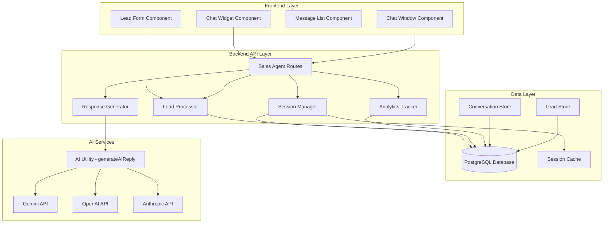
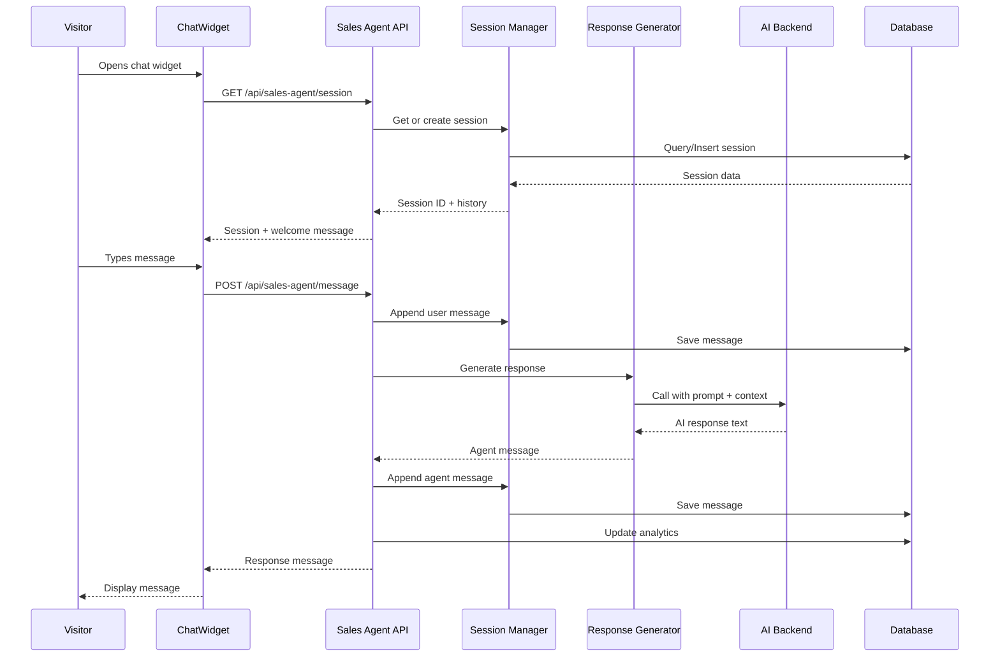

# Design Document: AI Sales Agent

## Overview

The AI Sales Agent is an intelligent conversational system that will be integrated into the Seevora website to automate sales engagement with potential clients. The system provides real-time chat-based interaction, service information delivery, lead capture, and conversation analytics.

### Key Objectives

1. **Automated Sales Engagement**: Provide 24/7 intelligent responses to visitor inquiries about Seevora services
2. **Lead Generation**: Convert interested visitors into qualified leads by capturing contact information
3. **Conversation Quality**: Deliver accurate, persuasive, and brand-appropriate responses
4. **Performance**: Handle high concurrent conversation volume with sub-5-second response times
5. **Integration**: Seamlessly integrate with existing Seevora infrastructure (Express, PostgreSQL, React, Vite)

### Technology Stack

- **Backend**: Node.js with Express (existing)
- **Database**: PostgreSQL (existing)
- **Frontend**: React 19 with Vite (existing)
- **AI Backend**: Google Gemini / OpenAI / Anthropic Claude (existing utility)
- **Real-time Updates**: HTTP polling / SSE for typing indicators
- **State Management**: React hooks and context

## Architecture

### High-Level Architecture



### Component Architecture

#### Frontend Components

1. **ChatWidget**: Minimized floating button (visible on all pages)
2. **ChatWindow**: Expanded conversation interface
3. **MessageList**: Scrollable message history display
4. **MessageBubble**: Individual message rendering (user/agent)
5. **ChatInput**: Text input with submit button
6. **TypingIndicator**: Animated indicator during AI response generation
7. **LeadCaptureForm**: Form component for collecting visitor information
8. **WelcomeMessage**: Initial greeting component

#### Backend Components

1. **Sales Agent Router** (`/api/sales-agent`): Express router handling all chat endpoints
2. **Session Manager**: Manages conversation sessions and persistence
3. **Response Generator**: Constructs prompts and calls AI backend
4. **Intent Classifier**: Analyzes user messages for intent (built into prompt)
5. **Lead Processor**: Validates and stores lead information
6. **Analytics Tracker**: Records conversation metrics
7. **Service Catalog Manager**: Provides service information to prompts

### Data Flow



## Components and Interfaces

### Frontend Components

#### 1. ChatWidget Component

**Location**: `src/components/SalesAgent/ChatWidget.jsx`

**Props**: None (self-contained)

**State**:
- `isExpanded`: boolean
- `unreadCount`: number
- `sessionId`: string | null

**Functionality**:
- Renders floating button in bottom-right corner
- Toggles between minimized and expanded states
- Shows unread message indicator
- Persists state in localStorage
- Visible on all public pages

**Styling**: Fixed position, z-index 1000, responsive

#### 2. ChatWindow Component

**Location**: `src/components/SalesAgent/ChatWindow.jsx`

**Props**:
- `isOpen`: boolean
- `onClose`: () => void
- `sessionId`: string | null

**State**:
- `messages`: Message[]
- `isLoading`: boolean
- `error`: string | null

**Functionality**:
- Displays conversation window (400px × 600px on desktop)
- Manages message list, input, and form components
- Handles scrolling to latest message
- Implements auto-scroll on new messages
- Shows typing indicator during AI response

#### 3. MessageList Component

**Location**: `src/components/SalesAgent/MessageList.jsx`

**Props**:
- `messages`: Message[]
- `isTyping`: boolean

**Functionality**:
- Renders scrollable message history
- Groups messages by sender
- Displays timestamps
- Auto-scrolls to bottom on new messages
- Shows typing indicator when agent is responding

#### 4. MessageBubble Component

**Location**: `src/components/SalesAgent/MessageBubble.jsx`

**Props**:
- `message`: Message
- `sender`: 'user' | 'agent'

**Functionality**:
- Renders individual message with appropriate styling
- Differentiates user vs agent messages (alignment, color)
- Displays timestamp
- Supports markdown formatting in agent responses

#### 5. ChatInput Component

**Location**: `src/components/SalesAgent/ChatInput.jsx`

**Props**:
- `onSend`: (message: string) => void
- `disabled`: boolean

**State**:
- `inputValue`: string

**Functionality**:
- Text input with send button
- Submit on Enter key (Shift+Enter for newline)
- Disabled state during AI response
- Character limit indicator (500 chars)
- Auto-focus on mount

#### 6. LeadCaptureForm Component

**Location**: `src/components/SalesAgent/LeadCaptureForm.jsx`

**Props**:
- `onSubmit`: (leadData: LeadData) => Promise<void>
- `onCancel`: () => void

**State**:
- `formData`: { name, email, phone, serviceInterest }
- `errors`: Record<string, string>
- `isSubmitting`: boolean

**Functionality**:
- Inline form displayed in chat window
- Real-time validation (email format, required fields)
- Submit button with loading state
- Error message display
- Cancel button to dismiss

#### 7. TypingIndicator Component

**Location**: `src/components/SalesAgent/TypingIndicator.jsx`

**Props**: None

**Functionality**:
- Animated "..." or "Agent is typing..." indicator
- Positioned in message list like agent message

### Backend API Endpoints

#### Base Route: `/api/sales-agent`

All endpoints follow REST conventions and return JSON responses.

#### 1. Create/Retrieve Session

```
GET /api/sales-agent/session
Query Parameters:
  - sessionId (optional): string - existing session ID
  - restore (optional): boolean - attempt to restore expired session

Response:
{
  "sessionId": "uuid",
  "messages": Message[],
  "welcomeMessage": string,
  "createdAt": timestamp,
  "expiresAt": timestamp
}

Error Responses:
  - 500: Server error
```

**Logic**:
- If `sessionId` provided and valid → return existing session with history
- If `sessionId` expired and `restore=true` → restore archived session
- Otherwise → create new session with UUID, store in DB, return with welcome message
- Welcome message generated using AI or static template

#### 2. Send Message

```
POST /api/sales-agent/message
Headers:
  - Content-Type: application/json

Body:
{
  "sessionId": "uuid",
  "message": "string (max 500 chars)"
}

Response:
{
  "messageId": "uuid",
  "agentResponse": "string",
  "timestamp": "ISO8601",
  "conversationEnded": boolean,
  "leadCapturePrompt": boolean (optional)
}

Error Responses:
  - 400: Invalid request (missing fields, message too long)
  - 404: Session not found
  - 429: Rate limit exceeded
  - 500: Server error
  - 504: AI timeout
```

**Logic**:
1. Validate request (session exists, message not empty, rate limit check)
2. Store user message in database
3. Retrieve last 10 messages from conversation history
4. Construct AI prompt with system instructions + context + user message
5. Call AI backend (with 5-second timeout)
6. Store agent response in database
7. Update session last_activity timestamp
8. Check if lead capture should be prompted (via AI signal or heuristic)
9. Return response

**Rate Limiting**: 20 messages per session per minute

#### 3. Submit Lead Information

```
POST /api/sales-agent/lead
Headers:
  - Content-Type: application/json

Body:
{
  "sessionId": "uuid",
  "name": "string (required, max 200 chars)",
  "email": "string (required, valid email format)",
  "phone": "string (optional, max 40 chars)",
  "serviceInterest": "string (required, max 200 chars)"
}

Response:
{
  "leadId": "uuid",
  "message": "Thank you! We'll be in touch soon.",
  "success": true
}

Error Responses:
  - 400: Validation error (invalid email, missing required fields)
  - 404: Session not found
  - 409: Lead already captured for this session
  - 500: Server error
```

**Logic**:
1. Validate request data (email format, required fields)
2. Check if lead already captured for this session
3. Create lead record in database
4. Link lead to conversation session
5. Update conversation analytics (conversion = true)
6. Return success message

#### 4. End Session

```
POST /api/sales-agent/session/end
Headers:
  - Content-Type: application/json

Body:
{
  "sessionId": "uuid"
}

Response:
{
  "success": true,
  "message": "Session ended"
}

Error Responses:
  - 404: Session not found
  - 500: Server error
```

**Logic**:
1. Update session status to 'ended'
2. Record end time
3. Archive conversation if appropriate
4. Update analytics

#### 5. Get Admin Dashboard Data

```
GET /api/sales-agent/admin/dashboard
Headers:
  - Authorization: Bearer <jwt_token>

Query Parameters:
  - startDate (optional): ISO date
  - endDate (optional): ISO date

Response:
{
  "totalConversations": number,
  "activeConversations": number,
  "totalLeads": number,
  "conversionRate": number,
  "avgConversationLength": number,
  "avgResponseTime": number,
  "topServices": Array<{service: string, count: number}>,
  "conversationsByDay": Array<{date: string, count: number}>
}

Error Responses:
  - 401: Unauthorized
  - 403: Forbidden (not admin)
  - 500: Server error
```

#### 6. Get Conversation History (Admin)

```
GET /api/sales-agent/admin/conversations/:sessionId
Headers:
  - Authorization: Bearer <jwt_token>

Response:
{
  "sessionId": "uuid",
  "messages": Message[],
  "lead": Lead | null,
  "analytics": {
    "messageCount": number,
    "duration": number,
    "servicesDiscussed": string[],
    "conversionStatus": string
  },
  "createdAt": timestamp,
  "endedAt": timestamp | null
}

Error Responses:
  - 401: Unauthorized
  - 403: Forbidden
  - 404: Conversation not found
  - 500: Server error
```

#### 7. Update System Prompt (Admin)

```
PUT /api/sales-agent/admin/prompt
Headers:
  - Authorization: Bearer <jwt_token>
  - Content-Type: application/json

Body:
{
  "systemPrompt": "string"
}

Response:
{
  "success": true,
  "message": "System prompt updated"
}

Error Responses:
  - 401: Unauthorized
  - 403: Forbidden
  - 400: Invalid prompt
  - 500: Server error
```

**Logic**:
1. Validate admin permissions
2. Store new system prompt in system_settings table
3. Prompt takes effect immediately for new conversations

## Data Models

### Database Schema

#### 1. sales_agent_sessions

Stores chat session metadata and state.

```sql
CREATE TABLE sales_agent_sessions (
  id UUID PRIMARY KEY DEFAULT gen_random_uuid(),
  session_id VARCHAR(100) UNIQUE NOT NULL,
  visitor_id VARCHAR(100), -- Cookie/fingerprint for visitor tracking
  ip_address VARCHAR(45),
  user_agent TEXT,
  status VARCHAR(40) NOT NULL DEFAULT 'active', -- active, ended, archived
  lead_captured BOOLEAN NOT NULL DEFAULT false,
  lead_id UUID REFERENCES sales_agent_leads(id) ON DELETE SET NULL,
  message_count INTEGER NOT NULL DEFAULT 0,
  services_discussed TEXT[], -- Array of service names
  last_activity_at TIMESTAMPTZ NOT NULL DEFAULT NOW(),
  created_at TIMESTAMPTZ NOT NULL DEFAULT NOW(),
  ended_at TIMESTAMPTZ,
  archived_at TIMESTAMPTZ
);

CREATE INDEX idx_sessions_session_id ON sales_agent_sessions(session_id);
CREATE INDEX idx_sessions_status ON sales_agent_sessions(status);
CREATE INDEX idx_sessions_created_at ON sales_agent_sessions(created_at DESC);
CREATE INDEX idx_sessions_last_activity ON sales_agent_sessions(last_activity_at DESC);
```

**Fields**:
- `id`: Primary key
- `session_id`: Unique identifier sent to frontend
- `visitor_id`: Optional tracking ID for repeat visitors
- `ip_address`: Client IP for analytics
- `user_agent`: Browser/device info
- `status`: Current session state
- `lead_captured`: Whether lead info was collected
- `lead_id`: Reference to captured lead
- `message_count`: Total messages in conversation
- `services_discussed`: Services mentioned during chat
- `last_activity_at`: Last message timestamp (for cleanup)
- `created_at`: Session start time
- `ended_at`: Session end time
- `archived_at`: When session was archived (after 24h)

#### 2. sales_agent_messages

Stores all messages exchanged in conversations.

```sql
CREATE TABLE sales_agent_messages (
  id UUID PRIMARY KEY DEFAULT gen_random_uuid(),
  session_id UUID NOT NULL REFERENCES sales_agent_sessions(id) ON DELETE CASCADE,
  sender VARCHAR(20) NOT NULL, -- 'user' or 'agent'
  message_text TEXT NOT NULL,
  metadata JSONB, -- Optional: intent classification, confidence scores
  created_at TIMESTAMPTZ NOT NULL DEFAULT NOW()
);

CREATE INDEX idx_messages_session_id ON sales_agent_messages(session_id, created_at ASC);
CREATE INDEX idx_messages_created_at ON sales_agent_messages(created_at DESC);
```

**Fields**:
- `id`: Primary key
- `session_id`: Reference to conversation session
- `sender`: 'user' or 'agent'
- `message_text`: Message content
- `metadata`: Optional JSON data (intent, sentiment, etc.)
- `created_at`: Message timestamp

#### 3. sales_agent_leads

Stores captured lead information.

```sql
CREATE TABLE sales_agent_leads (
  id UUID PRIMARY KEY DEFAULT gen_random_uuid(),
  session_id UUID NOT NULL REFERENCES sales_agent_sessions(id) ON DELETE CASCADE,
  name VARCHAR(200) NOT NULL,
  email VARCHAR(255) NOT NULL,
  phone VARCHAR(40),
  service_interest VARCHAR(200) NOT NULL,
  source VARCHAR(80) NOT NULL DEFAULT 'sales_agent',
  status VARCHAR(40) NOT NULL DEFAULT 'new', -- new, contacted, qualified, converted
  notes TEXT,
  created_at TIMESTAMPTZ NOT NULL DEFAULT NOW(),
  updated_at TIMESTAMPTZ NOT NULL DEFAULT NOW()
);

CREATE INDEX idx_leads_email ON sales_agent_leads(LOWER(email));
CREATE INDEX idx_leads_status ON sales_agent_leads(status);
CREATE INDEX idx_leads_created_at ON sales_agent_leads(created_at DESC);
```

**Fields**:
- `id`: Primary key
- `session_id`: Reference to conversation that generated lead
- `name`: Lead's full name
- `email`: Lead's email address (validated)
- `phone`: Optional phone number
- `service_interest`: Service they're interested in
- `source`: Always 'sales_agent'
- `status`: Lead stage in pipeline
- `notes`: Additional context from conversation
- `created_at`: Lead capture timestamp
- `updated_at`: Last modification timestamp

#### 4. sales_agent_analytics

Stores conversation-level analytics data.

```sql
CREATE TABLE sales_agent_analytics (
  id UUID PRIMARY KEY DEFAULT gen_random_uuid(),
  session_id UUID NOT NULL REFERENCES sales_agent_sessions(id) ON DELETE CASCADE,
  event_type VARCHAR(60) NOT NULL, -- session_start, message_sent, lead_captured, session_end
  event_data JSONB,
  created_at TIMESTAMPTZ NOT NULL DEFAULT NOW()
);

CREATE INDEX idx_analytics_session_id ON sales_agent_analytics(session_id);
CREATE INDEX idx_analytics_event_type ON sales_agent_analytics(event_type);
CREATE INDEX idx_analytics_created_at ON sales_agent_analytics(created_at DESC);
```

**Fields**:
- `id`: Primary key
- `session_id`: Reference to session
- `event_type`: Type of analytics event
- `event_data`: JSON payload with event details
- `created_at`: Event timestamp

**Event Types**:
- `session_start`: New conversation initiated
- `message_sent`: User sent a message
- `agent_response`: Agent responded
- `lead_capture_offered`: Lead form presented
- `lead_captured`: Lead info successfully collected
- `session_end`: Conversation ended

#### 5. System Settings Update

The existing `system_settings` table will store the AI sales agent system prompt.

**New Setting**:
```sql
INSERT INTO system_settings (key, value)
VALUES ('ai_sales_agent_prompt', '<default_system_prompt>')
ON CONFLICT (key) DO NOTHING;
```

### TypeScript/JavaScript Types

#### Message Type

```typescript
interface Message {
  id: string;
  sessionId: string;
  sender: 'user' | 'agent';
  messageText: string;
  metadata?: Record<string, any>;
  createdAt: string; // ISO 8601
}
```

#### Session Type

```typescript
interface Session {
  id: string;
  sessionId: string;
  visitorId?: string;
  status: 'active' | 'ended' | 'archived';
  leadCaptured: boolean;
  leadId?: string;
  messageCount: number;
  servicesDiscussed: string[];
  lastActivityAt: string;
  createdAt: string;
  endedAt?: string;
}
```

#### Lead Type

```typescript
interface Lead {
  id: string;
  sessionId: string;
  name: string;
  email: string;
  phone?: string;
  serviceInterest: string;
  source: string;
  status: 'new' | 'contacted' | 'qualified' | 'converted';
  notes?: string;
  createdAt: string;
  updatedAt: string;
}
```

#### Analytics Event Type

```typescript
interface AnalyticsEvent {
  id: string;
  sessionId: string;
  eventType: 'session_start' | 'message_sent' | 'agent_response' | 
             'lead_capture_offered' | 'lead_captured' | 'session_end';
  eventData?: Record<string, any>;
  createdAt: string;
}
```

#### Dashboard Analytics Type

```typescript
interface DashboardAnalytics {
  totalConversations: number;
  activeConversations: number;
  totalLeads: number;
  conversionRate: number; // percentage
  avgConversationLength: number; // messages
  avgResponseTime: number; // milliseconds
  topServices: Array<{
    service: string;
    count: number;
  }>;
  conversationsByDay: Array<{
    date: string;
    count: number;
  }>;
}
```

## AI Prompt Engineering

### System Prompt Structure

The system prompt defines the AI Sales Agent's behavior, knowledge, and boundaries. It will be stored in the `system_settings` table with key `ai_sales_agent_prompt`.

### Default System Prompt

```
You are an AI Sales Agent for Seevora Private Limited, an Indian AI automation company.

## Your Role
- Help potential clients understand Seevora's AI automation solutions
- Answer questions about services, pricing, implementation, and industries served
- Guide interested visitors toward booking a consultation or providing contact information
- Maintain a professional, helpful, and confident tone

## Company Information
Seevora specializes in custom Enterprise AI automation for SMBs in India.

### Core Services:
1. **24/7 AI Voice Receptionist**
   - Handles missed calls automatically
   - Books appointments
   - Captures customer intent
   - Routes urgent queries to humans

2. **WhatsApp Business API Automation**
   - Automated confirmations and reminders
   - Follow-up sequences
   - Payment link distribution
   - Document collection
   - Customer status updates

3. **Multi-language Support**
   - Hindi-first approach
   - English and Hinglish supported
   - Natural conversation flow

4. **Custom Integrations**
   - Calendar systems
   - Billing software
   - EMR/LIS systems
   - CRMs
   - UPI payment workflows
   - Document management
   - Business databases

### Industries Served:
- Healthcare & Clinics
- Education & Coaching
- Personal Care & Wellness
- Diagnostics & Pathology
- Fitness & Gyms
- Legal, CA & Financial Advisory
- Real Estate & Property

### Implementation:
- Typical setup: 5 business days
- Includes workflow audit and rule mapping
- Custom pricing based on modules, integrations, and volume

### Pricing:
- Custom quotes based on specific needs
- Encourage booking a discovery call for accurate pricing

## Your Guidelines

### Do:
- Be conversational and friendly while maintaining professionalism
- Ask clarifying questions to understand visitor needs
- Highlight relevant services based on their industry or problem
- Address concerns and objections with facts and social proof
- Suggest booking a consultation when appropriate
- Collect contact information from interested visitors

### Don't:
- Answer questions unrelated to Seevora or business automation
- Provide specific legal advice or guaranteed regulatory compliance
- Make promises about specific outcomes or ROI without qualification
- Engage with profanity, abuse, or inappropriate topics
- Invent features or capabilities not listed above
- Give exact pricing without understanding requirements

### Lead Capture:
When a visitor shows strong interest (asks about implementation, pricing, or expresses need), offer to collect their information:

"I'd love to connect you with our team for a personalized consultation. Can I get your name, email, and the service you're most interested in?"

Keep responses concise (2-3 sentences typical, 4-5 maximum for complex topics).
```

### Context Window Management

The Response Generator will include:
1. **System Prompt**: Full prompt above
2. **Conversation History**: Last 10 messages (5 user, 5 agent)
3. **Current User Message**: The latest message to respond to

**Prompt Format**:
```
System: <system_prompt>

Conversation History:
User: <message_1>
Agent: <response_1>
User: <message_2>
Agent: <response_2>
...

Current Message:
User: <current_message>

Agent:
```

### AI Model Configuration

**Primary Model**: Google Gemini 1.5 Flash (via existing `generateAIReply` utility)
**Fallback**: OpenAI GPT-4 or Anthropic Claude (if configured)

**Parameters**:
- `max_tokens`: 350
- `temperature`: 0.7
- `timeout`: 5000ms

## Error Handling

### Error Categories

#### 1. Client Errors (4xx)

**400 Bad Request**:
- Missing required fields
- Message exceeds character limit
- Invalid email format in lead submission
- Malformed request body

**Response Format**:
```json
{
  "error": "Bad Request",
  "message": "Message exceeds maximum length of 500 characters",
  "code": "MESSAGE_TOO_LONG"
}
```

**404 Not Found**:
- Session ID doesn't exist
- Conversation not found for admin view

**Response Format**:
```json
{
  "error": "Not Found",
  "message": "Session not found",
  "code": "SESSION_NOT_FOUND"
}
```

**409 Conflict**:
- Lead already captured for session
- Duplicate email submission

**Response Format**:
```json
{
  "error": "Conflict",
  "message": "Lead information already captured for this session",
  "code": "LEAD_ALREADY_CAPTURED"
}
```

**429 Too Many Requests**:
- Rate limit exceeded (>20 messages per minute per session)

**Response Format**:
```json
{
  "error": "Too Many Requests",
  "message": "Rate limit exceeded. Please slow down.",
  "code": "RATE_LIMIT_EXCEEDED",
  "retryAfter": 60
}
```

#### 2. Server Errors (5xx)

**500 Internal Server Error**:
- Database connection failure
- Unexpected exception

**Response Format**:
```json
{
  "error": "Internal Server Error",
  "message": "An unexpected error occurred. Please try again.",
  "code": "INTERNAL_ERROR"
}
```

**503 Service Unavailable**:
- AI backend not configured
- Database unavailable

**Response Format**:
```json
{
  "error": "Service Unavailable",
  "message": "AI service is temporarily unavailable",
  "code": "SERVICE_UNAVAILABLE"
}
```

**504 Gateway Timeout**:
- AI API exceeds 5-second timeout

**Response Format**:
```json
{
  "error": "Gateway Timeout",
  "message": "AI response took too long. Please try again.",
  "code": "AI_TIMEOUT"
}
```

### Error Handling Strategy

#### Backend

1. **Database Errors**:
   - Log error details
   - Return generic 500 error to client
   - Implement connection retry logic
   - Monitor error rates

2. **AI API Errors**:
   - Implement timeout (5 seconds)
   - Retry once on network error
   - Fallback to different AI provider if available
   - Return user-friendly error message

3. **Validation Errors**:
   - Return specific error codes
   - Include field-level error messages
   - Log validation failures for analysis

4. **Rate Limiting**:
   - Track requests per session using in-memory Map
   - Clean up old entries periodically
   - Return 429 with retry-after header

#### Frontend

1. **Network Errors**:
   - Display user-friendly error message
   - Show retry button
   - Disable submit during retry

2. **Timeout Handling**:
   - Show "Taking longer than expected..." after 3 seconds
   - Allow user to cancel and retry
   - Keep message in input field for easy retry

3. **Session Expiry**:
   - Detect 404 errors
   - Offer to start new conversation
   - Preserve unsent message

4. **Validation Errors**:
   - Show inline error messages
   - Highlight invalid fields
   - Provide helpful correction hints

### Graceful Degradation

1. **AI Service Unavailable**:
   - Display message: "Our AI assistant is temporarily unavailable. Please email us at contact@seevora.in or call +91..."
   - Offer contact form as alternative

2. **Slow Responses**:
   - Show extended typing indicator
   - Display estimated wait time after 3 seconds
   - Allow user to continue browsing while waiting

3. **Database Issues**:
   - Cache messages in localStorage temporarily
   - Attempt to sync when service recovers
   - Warn user about unsaved state

## Testing Strategy

This feature involves complex user interactions, AI integration, and database operations. Testing must cover functionality, performance, edge cases, and integration points.

### Unit Testing

**Backend**:
- **Session Manager**: Test session creation, retrieval, archival, cleanup
- **Response Generator**: Test prompt construction, context management, AI call handling
- **Lead Processor**: Test validation logic, duplicate detection, database insertion
- **Analytics Tracker**: Test event recording, metrics calculation
- **Rate Limiter**: Test request tracking, limit enforcement, cleanup

**Frontend**:
- **ChatWidget**: Test expand/collapse, unread indicator, persistence
- **MessageList**: Test rendering, scrolling, timestamp display
- **ChatInput**: Test character limit, submit handling, keyboard shortcuts
- **LeadCaptureForm**: Test validation, error display, submission

### Integration Testing

1. **API Endpoint Tests**:
   - Test each endpoint with valid requests
   - Test with invalid/missing parameters
   - Test error responses
   - Test rate limiting
   - Test authentication (admin endpoints)

2. **Database Integration**:
   - Test schema creation
   - Test CRUD operations for all tables
   - Test foreign key constraints
   - Test indexes
   - Test concurrent access

3. **AI Integration**:
   - Test with mock AI responses
   - Test timeout handling
   - Test error responses from AI API
   - Test fallback to alternative AI providers

### End-to-End Testing

**User Flows**:

1. **New Visitor Conversation**:
   - Open chat widget
   - Receive welcome message
   - Send message
   - Receive AI response
   - Ask about services
   - Submit lead information
   - Verify lead stored in database

2. **Returning Visitor**:
   - Open chat with existing session ID
   - Verify conversation history restored
   - Continue conversation
   - Close and reopen (verify persistence)

3. **Session Expiry**:
   - Create session
   - Wait 24+ hours (or mock timestamp)
   - Attempt to restore
   - Verify new session created

4. **Admin Dashboard**:
   - Login as admin
   - View dashboard metrics
   - View specific conversation
   - Update system prompt

### Performance Testing

1. **Concurrent Conversations**:
   - Simulate 50 concurrent sessions
   - Verify response times under 5 seconds
   - Verify no data corruption

2. **Load Testing**:
   - Simulate 100 concurrent sessions
   - Monitor response times
   - Check for memory leaks
   - Verify database connection pooling

3. **AI Response Time**:
   - Measure average AI response time
   - Test timeout handling
   - Verify graceful degradation under load

### Edge Case Testing

1. **Network Issues**:
   - Test disconnect during AI response
   - Test reconnection handling
   - Test message queue on reconnect

2. **Invalid Input**:
   - Very long messages (>500 chars)
   - Empty messages
   - Special characters and Unicode
   - SQL injection attempts
   - XSS attempts

3. **Session Edge Cases**:
   - Expired session access
   - Duplicate session creation
   - Concurrent requests on same session
   - Session limit exceeded

4. **Lead Capture Edge Cases**:
   - Duplicate email submission
   - Invalid email formats
   - Missing required fields
   - Very long field values

5. **Rate Limiting**:
   - Exactly at limit
   - Burst requests
   - Gradual recovery after limit

### Security Testing

1. **Input Validation**:
   - Test SQL injection prevention
   - Test XSS prevention
   - Test command injection prevention

2. **Authentication**:
   - Test admin endpoint protection
   - Test JWT validation
   - Test unauthorized access attempts

3. **Data Privacy**:
   - Verify lead data encryption in transit
   - Test access control on conversation history
   - Verify no sensitive data in logs

### Test Data

**Sample Messages**:
- "What services does Seevora offer?"
- "I run a dental clinic in Mumbai. Can you help?"
- "How much does it cost?"
- "How long does implementation take?"
- "Do you support Hindi?"
- "I'm interested in the WhatsApp automation"

**Sample Leads**:
```json
{
  "name": "Rajesh Kumar",
  "email": "rajesh.kumar@example.com",
  "phone": "+91 98765 43210",
  "serviceInterest": "AI Voice Receptionist for clinic"
}
```

**Sample Invalid Inputs**:
- Empty message: ""
- Too long: "a" * 501
- SQL injection: "'; DROP TABLE sales_agent_sessions; --"
- XSS: "<script>alert('xss')</script>"
- Invalid email: "not-an-email"

## Implementation Plan

### Phase 1: Backend Foundation (Week 1)

**Tasks**:
1. Create database schema (all 4 tables)
2. Add migration script to `server/db/init.js`
3. Create `/server/routes/salesAgent.js` router
4. Implement Session Manager module
5. Implement basic message endpoint (no AI yet)
6. Add to `server/index.js` routing
7. Write unit tests for Session Manager

**Deliverables**:
- Database tables created
- Session management working
- Basic API endpoints functional

### Phase 2: AI Integration (Week 1-2)

**Tasks**:
1. Create default system prompt
2. Store prompt in system_settings table
3. Implement Response Generator using `generateAIReply` utility
4. Add prompt construction logic
5. Add context window management
6. Implement AI timeout handling
7. Test AI responses with various inputs
8. Write unit tests for Response Generator

**Deliverables**:
- AI responses working
- System prompt configurable
- Error handling for AI failures

### Phase 3: Lead Capture (Week 2)

**Tasks**:
1. Implement lead submission endpoint
2. Add email validation
3. Add duplicate detection
4. Link leads to sessions
5. Update analytics on lead capture
6. Write integration tests for lead flow
7. Test edge cases (duplicate, invalid)

**Deliverables**:
- Lead capture API functional
- Validation working
- Leads stored correctly

### Phase 4: Frontend Components (Week 2-3)

**Tasks**:
1. Create ChatWidget component (minimized state)
2. Create ChatWindow component (expanded state)
3. Create MessageList component
4. Create MessageBubble component
5. Create ChatInput component
6. Create TypingIndicator component
7. Add session API integration
8. Add message API integration
9. Implement localStorage persistence
10. Add CSS styling

**Deliverables**:
- All React components created
- API integration complete
- Basic styling applied

### Phase 5: Lead Form Integration (Week 3)

**Tasks**:
1. Create LeadCaptureForm component
2. Add form validation
3. Connect to lead API endpoint
4. Handle submission success/error
5. Integrate with ChatWindow
6. Test form flow end-to-end

**Deliverables**:
- Lead form functional
- Validation working
- Integrated with chat flow

### Phase 6: Analytics & Admin (Week 3-4)

**Tasks**:
1. Implement analytics tracking
2. Create admin dashboard endpoint
3. Create conversation history endpoint
4. Create system prompt update endpoint
5. Build admin dashboard UI page
6. Add conversation viewer
7. Add system prompt editor
8. Add authentication checks
9. Write tests for admin features

**Deliverables**:
- Analytics tracking working
- Admin dashboard functional
- Conversation history viewable
- System prompt editable

### Phase 7: Performance & Polish (Week 4)

**Tasks**:
1. Implement rate limiting
2. Add request timeout handling
3. Optimize database queries
4. Add database indexes
5. Implement session cleanup job
6. Test with 50-100 concurrent users
7. Fix performance issues
8. Add error tracking/logging
9. Polish UI/UX

**Deliverables**:
- Performance requirements met
- Rate limiting working
- Cleanup jobs running
- Production-ready

### Phase 8: Testing & Deployment (Week 4)

**Tasks**:
1. Complete unit test suite
2. Complete integration test suite
3. Perform end-to-end testing
4. Conduct security review
5. Load testing (100 concurrent sessions)
6. Fix bugs found in testing
7. Prepare deployment documentation
8. Deploy to production
9. Monitor for issues

**Deliverables**:
- All tests passing
- Security verified
- Performance validated
- Deployed to production

## Security Considerations

### Input Validation

1. **Message Validation**:
   - Maximum length: 500 characters
   - Sanitize for XSS
   - Block SQL injection attempts
   - Rate limit per session

2. **Lead Data Validation**:
   - Email format validation using regex
   - Maximum field lengths enforced
   - Sanitize all text inputs
   - Prevent duplicate submissions

3. **Session Security**:
   - Use UUID for session IDs (not sequential)
   - Validate session exists before operations
   - Implement session expiry (24 hours)
   - Clean up expired sessions regularly

### API Security

1. **Rate Limiting**:
   - 20 messages per session per minute
   - Track using in-memory Map with cleanup
   - Return 429 status code when exceeded

2. **Admin Endpoints**:
   - Require JWT authentication
   - Verify admin role from token
   - Log all admin actions
   - Implement audit trail

3. **CORS**:
   - Use existing CORS configuration
   - Allow only configured client origins
   - Include credentials for authenticated requests

4. **SQL Injection Prevention**:
   - Use parameterized queries exclusively
   - Never concatenate user input into SQL
   - Leverage pg library's built-in escaping

5. **XSS Prevention**:
   - Sanitize all user input before storage
   - Escape output in React components (handled by React)
   - Set appropriate Content-Security-Policy headers

### Data Privacy

1. **PII Protection**:
   - Store lead data securely
   - Implement access controls
   - Log access to sensitive data
   - Consider encryption at rest

2. **Conversation Privacy**:
   - Only admins can view conversations
   - Implement soft delete (archive vs hard delete)
   - GDPR compliance considerations
   - Provide data export mechanism

3. **Logging**:
   - Don't log sensitive data (passwords, full credit cards)
   - Log access attempts
   - Log security events
   - Implement log rotation

### AI Safety

1. **Prompt Injection Prevention**:
   - Clear separation between system prompt and user input
   - Validate AI responses don't leak system prompt
   - Monitor for unusual AI behavior

2. **Content Filtering**:
   - Detect and handle inappropriate user input
   - Monitor AI responses for policy violations
   - Flag conversations for review

3. **Guardrails**:
   - System prompt includes clear boundaries
   - AI instructed not to provide legal/medical advice
   - Limit response length to prevent abuse

## Performance Optimization

### Database Optimization

1. **Indexes**:
   - Session lookup by session_id (unique index)
   - Messages by session_id + created_at (composite)
   - Leads by email (for duplicate detection)
   - Analytics by event_type and created_at
   - Sessions by last_activity_at (for cleanup)

2. **Connection Pooling**:
   - Use existing pg Pool
   - Monitor pool size and wait times
   - Configure appropriate pool limits

3. **Query Optimization**:
   - Limit conversation history to last 10 messages
   - Use pagination for admin dashboard
   - Cache frequently accessed data (service catalog)

### Caching Strategy

1. **System Prompt Cache**:
   - Load on server start
   - Cache in memory
   - Invalidate on update
   - TTL: until manual update

2. **Service Catalog Cache**:
   - Cache service information in memory
   - Reduces database queries during AI prompts
   - Update when services change

3. **Session Cache** (Optional):
   - Use in-memory cache for active sessions
   - Reduces database reads
   - Sync to database periodically
   - Clear on session end

### Frontend Optimization

1. **Component Optimization**:
   - Use React.memo for MessageBubble
   - Virtualize message list for long conversations
   - Debounce input changes
   - Lazy load admin components

2. **Network Optimization**:
   - Compress API responses (gzip)
   - Minimize payload sizes
   - Batch analytics events
   - Use HTTP/2 if available

3. **Asset Optimization**:
   - Minimize CSS/JS bundles
   - Code split admin components
   - Optimize icons and images

### Scalability Considerations

1. **Horizontal Scaling**:
   - Stateless API design (session in DB)
   - Can add multiple server instances
   - Load balancer distributes traffic
   - Share database connection pool

2. **Session Cleanup**:
   - Background job runs every hour
   - Archives sessions inactive >24 hours
   - Hard deletes archived sessions >30 days
   - Prevents database bloat

3. **Rate Limiting**:
   - Per-session rate limiting
   - Prevents abuse
   - Scales with server instances

## Monitoring and Observability

### Metrics to Track

1. **Conversation Metrics**:
   - Total conversations started (daily, weekly, monthly)
   - Active conversations (real-time)
   - Average conversation length (messages)
   - Average conversation duration (time)
   - Conversation completion rate

2. **Lead Metrics**:
   - Leads captured (daily, weekly, monthly)
   - Conversion rate (leads / conversations)
   - Lead quality score (if implemented)
   - Lead source distribution

3. **Performance Metrics**:
   - Average AI response time
   - 95th percentile response time
   - API endpoint latency
   - Database query times
   - Error rates by type

4. **System Metrics**:
   - Concurrent active sessions
   - Database connection pool usage
   - Memory usage
   - CPU usage
   - Request rate

### Logging Strategy

1. **Application Logs**:
   - Log level: INFO for production
   - Include timestamp, level, message, context
   - Rotate logs daily
   - Retain 30 days

**Log Events**:
- Session creation/end
- AI API calls (duration, success/failure)
- Lead captures
- Errors and exceptions
- Admin actions
- Rate limit violations

2. **Access Logs**:
   - Log all API requests
   - Include IP, endpoint, status, duration
   - Use for traffic analysis
   - Detect abuse patterns

3. **Error Tracking**:
   - Capture stack traces
   - Group similar errors
   - Alert on error rate spikes
   - Include request context

### Alerting

**Alert Conditions**:
1. Error rate >5% over 5 minutes
2. AI response time >5 seconds (P95)
3. Database connection pool exhausted
4. Concurrent sessions >80 (approaching limit)
5. Lead capture failures >10% over 1 hour
6. Rate limit violations >100 per hour

### Dashboard Metrics

**Real-Time**:
- Active conversations count
- Messages per minute
- Current error rate
- AI response time (live)

**Historical**:
- Conversations by day/week/month
- Lead conversion trend
- Most discussed services
- Peak traffic times
- Error rate trends

## Deployment Considerations

### Environment Variables

Required environment variables (add to `.env`):

```bash
# AI Configuration (at least one required)
GEMINI_API_KEY=your_gemini_key
OPENAI_API_KEY=your_openai_key
ANTHROPIC_API_KEY=your_anthropic_key

# Database (existing)
DATABASE_URL=postgresql://...
PGHOST=localhost
PGPORT=5432
PGDATABASE=seevora_db
PGUSER=postgres
PGPASSWORD=password

# Server (existing)
PORT=4000
CLIENT_ORIGIN=http://localhost:5173

# JWT (existing)
JWT_SECRET=your_secret_key
```

### Database Migration

The database schema will be added to the existing `server/db/init.js` file, which runs automatically on server start. This ensures:
- Tables are created if they don't exist
- Indexes are added if missing
- No manual migration needed
- Safe for existing installations

### Deployment Steps

1. **Pre-deployment**:
   - Review code changes
   - Run test suite
   - Update environment variables
   - Backup database

2. **Deployment**:
   - Pull latest code
   - Install dependencies (`npm install`)
   - Run database migrations (automatic on start)
   - Start server (`npm start`)
   - Verify health endpoint

3. **Post-deployment**:
   - Monitor error logs
   - Check AI connectivity
   - Test chat widget on live site
   - Verify lead capture working
   - Monitor performance metrics

### Rollback Plan

If issues are detected post-deployment:

1. **Immediate Rollback**:
   - Revert to previous code version
   - Restart server
   - Monitor for stabilization

2. **Database Rollback** (if needed):
   - The schema is additive (new tables only)
   - No changes to existing tables
   - Safe to keep new tables even on code rollback
   - Can drop tables if necessary: `DROP TABLE IF EXISTS sales_agent_*`

3. **Partial Rollback** (disable feature):
   - Comment out route in `server/index.js`
   - Hide chat widget in frontend
   - Keep data for debugging

## Future Enhancements

### Phase 2 Features (Post-MVP)

1. **Multi-language Support**:
   - Detect visitor language preference
   - Support Hindi conversations
   - Translate system prompt dynamically

2. **Sentiment Analysis**:
   - Analyze visitor sentiment
   - Adjust agent tone accordingly
   - Flag frustrated visitors for human intervention

3. **Intent Classification**:
   - Classify visitor intent (information, pricing, support)
   - Route to appropriate response strategy
   - Improve lead qualification

4. **Proactive Engagement**:
   - Trigger chat based on visitor behavior
   - Time on page, scroll depth, exit intent
   - Personalized welcome messages

5. **CRM Integration**:
   - Sync leads to external CRM (Salesforce, HubSpot)
   - Two-way sync for lead status updates
   - Webhook notifications

6. **A/B Testing**:
   - Test different system prompts
   - Test different engagement strategies
   - Measure conversion impact
   - Optimize based on data

7. **Voice Integration**:
   - Voice input option
   - Text-to-speech for responses
   - Accessibility improvement

8. **Rich Media**:
   - Send images, videos in responses
   - Interactive service cards
   - Calendar integration for booking

9. **Human Handoff**:
   - Escalate complex queries to human agents
   - Seamless transition with context
   - Notify sales team via Slack/email

10. **Advanced Analytics**:
    - Funnel analysis (visitor → lead → customer)
    - Cohort analysis
    - Revenue attribution
    - Conversation heatmaps

### Technical Debt Considerations

1. **Session Management**:
   - Consider Redis for session caching at scale
   - Implement distributed rate limiting

2. **Real-time Updates**:
   - Migrate from polling to WebSocket/SSE
   - Reduce latency and server load

3. **AI Optimization**:
   - Fine-tune custom model for Seevora
   - Reduce token usage
   - Improve response quality

4. **Testing**:
   - Increase test coverage to >80%
   - Add visual regression tests
   - Automate load testing

## Appendix

### File Structure

```
seevora-website/
├── server/
│   ├── routes/
│   │   ├── salesAgent.js          # Main sales agent router (NEW)
│   │   └── ...
│   ├── utils/
│   │   ├── ai.js                  # Existing AI utility (REUSE)
│   │   ├── salesAgentPrompt.js    # System prompt manager (NEW)
│   │   └── validation.js          # Existing validation (REUSE)
│   ├── config/
│   │   └── db.js                  # Existing DB config (REUSE)
│   ├── db/
│   │   └── init.js                # Update with new schema (MODIFY)
│   └── index.js                   # Add sales agent route (MODIFY)
├── src/
│   ├── components/
│   │   └── SalesAgent/            # New directory
│   │       ├── ChatWidget.jsx         # (NEW)
│   │       ├── ChatWindow.jsx         # (NEW)
│   │       ├── MessageList.jsx        # (NEW)
│   │       ├── MessageBubble.jsx      # (NEW)
│   │       ├── ChatInput.jsx          # (NEW)
│   │       ├── LeadCaptureForm.jsx    # (NEW)
│   │       ├── TypingIndicator.jsx    # (NEW)
│   │       └── styles.css             # (NEW)
│   ├── hooks/
│   │   └── useSalesAgent.js       # Custom hook for API calls (NEW)
│   ├── pages/
│   │   └── AdminSalesAgent.jsx    # Admin dashboard page (NEW)
│   └── App.jsx                    # Add ChatWidget globally (MODIFY)
└── .env                           # Add AI API keys (MODIFY)
```

### API Endpoint Summary

| Method | Endpoint | Auth | Purpose |
|--------|----------|------|---------|
| GET | /api/sales-agent/session | None | Create/retrieve session |
| POST | /api/sales-agent/message | None | Send message, get AI response |
| POST | /api/sales-agent/lead | None | Submit lead information |
| POST | /api/sales-agent/session/end | None | End conversation |
| GET | /api/sales-agent/admin/dashboard | JWT | Get analytics dashboard |
| GET | /api/sales-agent/admin/conversations/:id | JWT | Get conversation history |
| PUT | /api/sales-agent/admin/prompt | JWT | Update system prompt |

### Database Table Summary

| Table | Purpose | Key Relationships |
|-------|---------|-------------------|
| sales_agent_sessions | Chat session metadata | → sales_agent_leads |
| sales_agent_messages | Message history | → sales_agent_sessions |
| sales_agent_leads | Captured lead info | → sales_agent_sessions |
| sales_agent_analytics | Event tracking | → sales_agent_sessions |
| system_settings | System prompt storage | (key-value store) |

### Key Decisions and Rationale

1. **Why PostgreSQL instead of Redis for sessions?**
   - Leverage existing infrastructure
   - Persistence without additional service
   - Can migrate to Redis later if needed
   - Simpler deployment

2. **Why not WebSockets for real-time?**
   - HTTP polling is simpler to implement
   - Reduces complexity for MVP
   - Easier to debug and monitor
   - Can upgrade to WebSocket in Phase 2

3. **Why store system prompt in database?**
   - Dynamic updates without deployment
   - Version history capability
   - A/B testing support
   - No code changes needed for prompt updates

4. **Why separate leads table instead of reusing audit_requests?**
   - Different data structure and fields
   - Separate concerns (audit vs sales)
   - Clearer analytics and reporting
   - Easier to extend with sales-specific features

5. **Why 24-hour session expiry?**
   - Balance between convenience and data hygiene
   - Visitors unlikely to resume after 24h
   - Prevents database bloat
   - Allows restoration if needed

6. **Why limit conversation history to last 10 messages?**
   - Balance context vs token usage
   - AI context window limitations
   - Reduces latency
   - Most relevant recent context

7. **Why 5-second AI timeout?**
   - User experience (requirement: <5s response)
   - Prevents hanging requests
   - Reasonable for AI API latency
   - Allows for retry logic

### References

- [Requirements Document](./requirements.md)
- [Express.js Documentation](https://expressjs.com/)
- [React 19 Documentation](https://react.dev/)
- [PostgreSQL Documentation](https://www.postgresql.org/docs/)
- [Google Gemini API](https://ai.google.dev/docs)
- [OpenAI API Documentation](https://platform.openai.com/docs)
- [Anthropic Claude API](https://docs.anthropic.com/)

---

**Document Version**: 1.0  
**Last Updated**: 2025  
**Author**: AI Design System  
**Status**: Ready for Implementation
