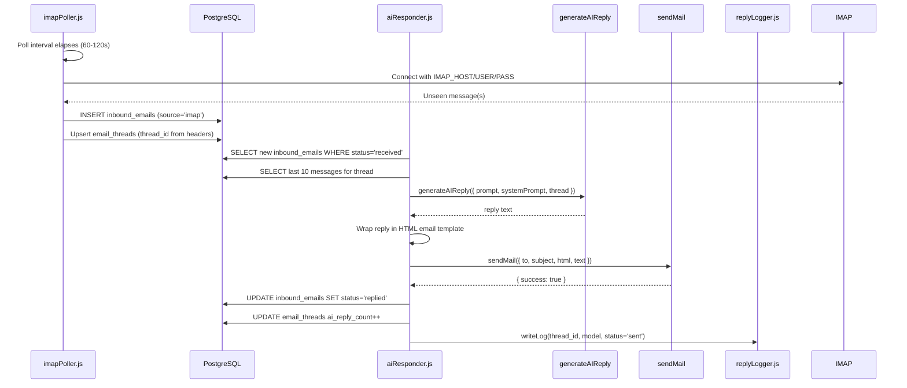
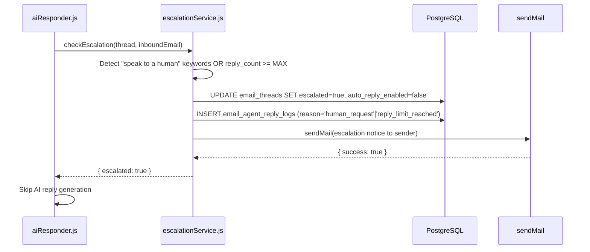
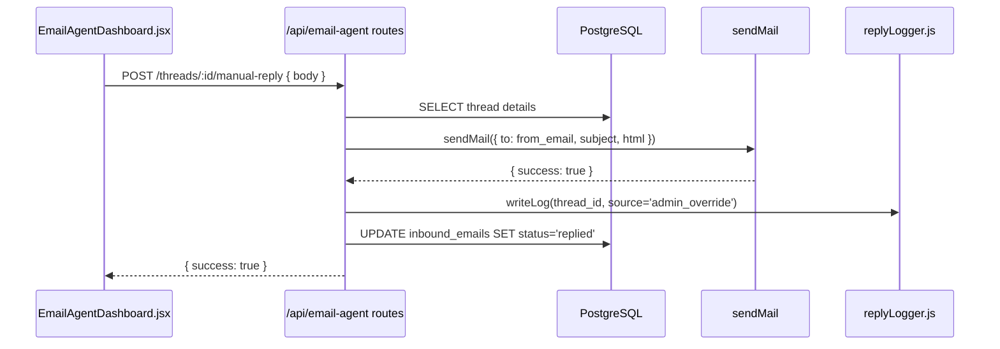

# Design Document: Email AI Sales Agent

## Overview

The Email AI Sales Agent is a fully-automated inbound email handling system for Seevora Private Limited. It monitors two sources — a live IMAP mailbox and the `inbound_emails` database table (populated by the website contact form) — then autonomously generates and sends AI-powered sales replies using Seevora's brand voice. The system maintains multi-turn thread context, escalates to humans at configurable thresholds, respects opt-outs, and exposes a protected admin dashboard for oversight and manual override.

The agent builds entirely on Seevora's existing infrastructure: `generateAIReply` (Anthropic / OpenAI / Gemini), `sendMail` (Nodemailer/SMTP), the PostgreSQL pool from `server/config/db.js`, and the `requireRole` auth middleware. No new authentication layer is required.

---

## Architecture

```mermaid
graph TD
    subgraph "Inbound Sources"
        IMAP[IMAP Mailbox<br/>imap npm package]
        CF[Contact Form<br/>inbound_emails table]
    end

    subgraph "Background Workers"
        IP[imapPoller.js<br/>60-120s interval]
        CFP[contactFormProcessor.js<br/>60s interval]
    end

    subgraph "Core Services"
        AR[aiResponder.js<br/>generateAIReply + HTML template]
        ES[escalationService.js<br/>trigger checks + final email]
        RL[replyLogger.js<br/>email_agent_reply_logs]
    end

    subgraph "Data Layer"
        DB[(PostgreSQL)]
        IE[inbound_emails]
        ET[email_threads]
        EL[email_agent_reply_logs]
        SS[subscribers]
        SYS[system_settings]
    end

    subgraph "Outbound"
        ML[sendMail<br/>mailer.js]
    end

    subgraph "Admin Layer"
        RT[/api/email-agent routes<br/>emailAgent.js]
        UI[EmailAgentDashboard.jsx<br/>EmailThreadViewer.jsx]
    end

    IMAP --> IP --> IE
    CF --> CFP --> IE
    IE --> AR --> ML
    AR --> ES
    AR --> RL
    ES --> ML
    RL --> EL
    IE --> ET
    RT --> DB
    UI --> RT
    SYS --> AR
    SS --> AR
```

---

## Sequence Diagrams

### IMAP Poll → AI Reply Flow



### Escalation Flow



### Admin Override Flow



---

## Database Schema

### New Tables

#### `email_threads`

Tracks conversation threads across multiple inbound/outbound messages.

```sql
CREATE TABLE email_threads (
  id UUID PRIMARY KEY DEFAULT gen_random_uuid(),
  thread_id VARCHAR(255) NOT NULL UNIQUE, -- Derived from In-Reply-To/References headers or from_email hash
  from_email VARCHAR(255) NOT NULL,
  from_name VARCHAR(200),
  subject TEXT,
  source VARCHAR(40) NOT NULL DEFAULT 'imap', -- 'imap' | 'contact_form'
  ai_reply_count INTEGER NOT NULL DEFAULT 0,
  total_messages INTEGER NOT NULL DEFAULT 0,
  escalated BOOLEAN NOT NULL DEFAULT false,
  escalation_reason VARCHAR(80), -- 'human_request' | 'reply_limit_reached'
  auto_reply_enabled BOOLEAN NOT NULL DEFAULT true,
  converted BOOLEAN NOT NULL DEFAULT false,
  conversion_type VARCHAR(60), -- 'booked_call' | 'service_inquiry'
  converted_at TIMESTAMPTZ,
  confirmed_by UUID REFERENCES users(id) ON DELETE SET NULL,
  created_at TIMESTAMPTZ NOT NULL DEFAULT NOW(),
  updated_at TIMESTAMPTZ NOT NULL DEFAULT NOW(),
  last_activity_at TIMESTAMPTZ NOT NULL DEFAULT NOW()
);

CREATE INDEX idx_threads_from_email ON email_threads(LOWER(from_email));
CREATE INDEX idx_threads_thread_id ON email_threads(thread_id);
CREATE INDEX idx_threads_escalated ON email_threads(escalated);
CREATE INDEX idx_threads_last_activity ON email_threads(last_activity_at DESC);
```

#### `email_agent_reply_logs`

Full audit trail for every outgoing reply the agent sends.

```sql
CREATE TABLE email_agent_reply_logs (
  id UUID PRIMARY KEY DEFAULT gen_random_uuid(),
  thread_id VARCHAR(255) NOT NULL,
  inbound_email_id UUID REFERENCES inbound_emails(id) ON DELETE SET NULL,
  to_email VARCHAR(255) NOT NULL,
  subject TEXT NOT NULL,
  reply_body_html TEXT NOT NULL,
  reply_body_text TEXT NOT NULL,
  ai_model_used VARCHAR(120), -- 'claude-3-5-sonnet-20241022' | 'gpt-4o-mini' | 'gemini-1.5-flash' | NULL for admin override
  source VARCHAR(40) NOT NULL DEFAULT 'ai', -- 'ai' | 'admin_override' | 'escalation' | 'unsubscribe_confirm'
  status VARCHAR(40) NOT NULL DEFAULT 'sent', -- 'sent' | 'failed'
  error_message TEXT,
  escalation_reason VARCHAR(80), -- populated when source='escalation'
  processing_duration_ms INTEGER, -- end-to-end time from inbound receipt to reply sent
  sent_at TIMESTAMPTZ NOT NULL DEFAULT NOW(),
  created_at TIMESTAMPTZ NOT NULL DEFAULT NOW()
);

CREATE INDEX idx_reply_logs_thread_id ON email_agent_reply_logs(thread_id);
CREATE INDEX idx_reply_logs_to_email ON email_agent_reply_logs(LOWER(to_email));
CREATE INDEX idx_reply_logs_sent_at ON email_agent_reply_logs(sent_at DESC);
CREATE INDEX idx_reply_logs_status ON email_agent_reply_logs(status);
```

### Additions to `inbound_emails`

The following columns are added to the existing `inbound_emails` table via `ALTER TABLE IF NOT EXISTS` in `db/init.js`:

```sql
ALTER TABLE inbound_emails ADD COLUMN IF NOT EXISTS from_name VARCHAR(200);
ALTER TABLE inbound_emails ADD COLUMN IF NOT EXISTS source VARCHAR(40) NOT NULL DEFAULT 'imap';
ALTER TABLE inbound_emails ADD COLUMN IF NOT EXISTS thread_id VARCHAR(255);
ALTER TABLE inbound_emails ADD COLUMN IF NOT EXISTS message_id VARCHAR(500); -- SMTP Message-ID header
ALTER TABLE inbound_emails ADD COLUMN IF NOT EXISTS in_reply_to VARCHAR(500); -- SMTP In-Reply-To header
ALTER TABLE inbound_emails ADD COLUMN IF NOT EXISTS processed_at TIMESTAMPTZ;
ALTER TABLE inbound_emails ADD COLUMN IF NOT EXISTS processing_duration_ms INTEGER;

-- status values: 'received' | 'replied' | 'escalated' | 'needs_review' | 'send_failed' | 'unsubscribed'
-- existing default 'received' is compatible

CREATE INDEX IF NOT EXISTS idx_inbound_emails_thread_id ON inbound_emails(thread_id);
CREATE INDEX IF NOT EXISTS idx_inbound_emails_status ON inbound_emails(status);
CREATE INDEX IF NOT EXISTS idx_inbound_emails_from_email ON inbound_emails(LOWER(from_email));
```

---

## Components and Interfaces

### 1. IMAP Poller — `server/services/emailAgent/imapPoller.js`

**Purpose**: Connects to the IMAP mailbox on a configurable interval, fetches UNSEEN messages, parses them with `mailparser`, saves to `inbound_emails`, and derives `thread_id` from email headers.

**Dependencies**: `imap` npm package, `mailparser` npm package, `server/config/db.js`

**Interface**:
```javascript
/**
 * Start the IMAP polling loop. Called once from server/index.js.
 * Reads IMAP_POLL_INTERVAL_SECONDS (30-3600, default 60).
 */
export function startImapPoller()

/**
 * Single poll execution. Connects to IMAP, fetches UNSEEN messages,
 * saves to DB, marks as SEEN, disconnects.
 * @returns {Promise<{ fetched: number, saved: number, errors: string[] }>}
 */
async function pollOnce()

/**
 * Derive a stable thread_id from email headers.
 * Priority: References header last ID > In-Reply-To > sha256(from+subject).
 * @param {ParsedMail} parsed
 * @returns {string} thread_id
 */
function deriveThreadId(parsed)
```

**Poll Interval Logic**:

```javascript
const rawInterval = parseInt(process.env.IMAP_POLL_INTERVAL_SECONDS, 10);
const intervalSeconds = Number.isInteger(rawInterval) && rawInterval >= 30 && rawInterval <= 3600
  ? rawInterval
  : 60; // default + warn

setInterval(async () => {
  try {
    await pollOnce();
  } catch (err) {
    console.error('[ImapPoller] Unhandled error:', err.message);
    // Do NOT rethrow — poller must keep running
  }
}, intervalSeconds * 1000);
```

**IMAP Connection Pattern**:

```javascript
import Imap from 'imap';
import { simpleParser } from 'mailparser';

const imap = new Imap({
  user: process.env.IMAP_USER,
  password: process.env.IMAP_PASS,
  host: process.env.IMAP_HOST,
  port: parseInt(process.env.IMAP_PORT || '993'),
  tls: true,
  tlsOptions: { rejectUnauthorized: false },
  connTimeout: 15000,
  authTimeout: 10000,
});

// Open INBOX, search UNSEEN, fetch with body, parse with simpleParser,
// mark as SEEN after successful DB save.
```

### 2. Contact Form Processor — `server/services/emailAgent/contactFormProcessor.js`

**Purpose**: Polls `inbound_emails` every 60 seconds for records with `source='contact_form'` and `status='received'` that have not yet been processed. Assigns `thread_id` and hands off to `aiResponder`.

**Interface**:
```javascript
/**
 * Start the contact form polling loop. Called once from server/index.js.
 */
export function startContactFormProcessor()

/**
 * Single processing pass.
 * Queries DB for unprocessed contact form submissions, assigns thread_ids,
 * triggers aiResponder for each.
 * @returns {Promise<{ processed: number, errors: number }>}
 */
async function processNewContactForms()

/**
 * Derive a thread_id for a contact form submission.
 * Uses sha256(from_email + normalised_subject) to ensure idempotency.
 * @param {string} fromEmail
 * @param {string} subject
 * @returns {string} thread_id
 */
function deriveContactFormThreadId(fromEmail, subject)
```

**DB Query Pattern**:

```javascript
const { rows } = await pool.query(`
  SELECT ie.*
  FROM inbound_emails ie
  LEFT JOIN email_threads et ON et.thread_id = ie.thread_id
  WHERE ie.source = 'contact_form'
    AND ie.status = 'received'
    AND ie.processed_at IS NULL
    AND ie.created_at >= NOW() - INTERVAL '10 minutes'
  ORDER BY ie.created_at ASC
  LIMIT 20
`);
```

---

### 3. AI Responder — `server/services/emailAgent/aiResponder.js`

**Purpose**: Core orchestrator. Receives an `inbound_emails` record, checks preconditions (subscribed, not escalated, auto-reply enabled, under reply limit), builds the thread history, calls `generateAIReply`, formats the HTML reply, sends via `sendMail`, then delegates logging and escalation checks.

**Interface**:
```javascript
/**
 * Process a single inbound email and send an AI reply if conditions are met.
 * @param {object} inboundEmail - Row from inbound_emails
 * @returns {Promise<{ sent: boolean, reason?: string }>}
 */
export async function processInboundEmail(inboundEmail)

/**
 * Build the thread history array for generateAIReply.
 * Queries inbound_emails + reply_logs for thread, sorts by created_at ASC, 
 * returns last 10 messages as { sender: 'user'|'agent', text: string }[].
 * @param {string} threadId
 * @returns {Promise<Array<{ sender: string, text: string }>>}
 */
async function buildThreadHistory(threadId)

/**
 * Read MAX_AI_REPLIES_PER_THREAD from system_settings, fall back to env var, default 5.
 * @returns {Promise<number>}
 */
async function getMaxReplies()
```

**Processing Algorithm**:

```javascript
async function processInboundEmail(inboundEmail) {
  const startTime = Date.now();

  // 1. Check unsubscribed
  const { rows: subRows } = await pool.query(
    `SELECT status FROM subscribers WHERE LOWER(email) = LOWER($1)`,
    [inboundEmail.from_email]
  );
  if (subRows[0]?.status === 'unsubscribed') {
    return { sent: false, reason: 'unsubscribed' };
  }

  // 2. Detect unsubscribe keywords in body
  const UNSUB_KEYWORDS = ['unsubscribe', 'stop emails', 'remove me', 'opt out'];
  if (UNSUB_KEYWORDS.some(kw => inboundEmail.body?.toLowerCase().includes(kw))) {
    await handleUnsubscribe(inboundEmail);
    return { sent: false, reason: 'unsubscribe_processed' };
  }

  // 3. Upsert thread record
  const thread = await upsertThread(inboundEmail);

  // 4. Check escalation + auto_reply
  if (thread.escalated || !thread.auto_reply_enabled) {
    return { sent: false, reason: 'escalated_or_disabled' };
  }

  // 5. Check escalation triggers (keywords OR reply count)
  const maxReplies = await getMaxReplies();
  const ESCALATION_KEYWORDS = [
    'speak to a human', 'talk to a person', 'human agent',
    'real person', 'contact a representative',
  ];
  const needsEscalation =
    ESCALATION_KEYWORDS.some(kw => inboundEmail.body?.toLowerCase().includes(kw)) ||
    thread.ai_reply_count >= maxReplies;

  if (needsEscalation) {
    await escalationService.escalateThread(thread, inboundEmail);
    return { sent: false, reason: 'escalated' };
  }

  // 6. Detect potential conversion keywords
  const CONVERSION_KEYWORDS = [
    'book a call', 'schedule a meeting',
    'interested in your services', 'want to know more',
  ];
  if (CONVERSION_KEYWORDS.some(kw => inboundEmail.body?.toLowerCase().includes(kw))) {
    await pool.query(
      `UPDATE email_threads SET converted = true WHERE thread_id = $1`,
      [thread.thread_id]
    );
  }

  // 7. Build thread history
  const history = await buildThreadHistory(thread.thread_id);

  // 8. Call generateAIReply
  const replyText = await generateAIReply({
    prompt: inboundEmail.body,
    systemPrompt: SEEVORA_SALES_SYSTEM_PROMPT,
    thread: history,
  });

  if (!replyText) {
    await pool.query(`UPDATE inbound_emails SET status='needs_review' WHERE id=$1`, [inboundEmail.id]);
    return { sent: false, reason: 'ai_empty_response' };
  }

  // 9. Format HTML reply
  const replyHtml = buildReplyHtml(inboundEmail, replyText);
  const replySubject = inboundEmail.subject?.startsWith('Re:')
    ? inboundEmail.subject
    : `Re: ${inboundEmail.subject || 'Your enquiry'}`;

  // 10. Send via sendMail
  const mailResult = await sendMail({
    to: inboundEmail.from_email,
    subject: replySubject,
    html: replyHtml,
    text: replyText,
  });

  const duration = Date.now() - startTime;

  // 11. Log reply
  await replyLogger.writeLog({
    threadId: thread.thread_id,
    inboundEmailId: inboundEmail.id,
    toEmail: inboundEmail.from_email,
    subject: replySubject,
    replyBodyHtml: replyHtml,
    replyBodyText: replyText,
    aiModelUsed: detectModelUsed(),
    source: 'ai',
    status: mailResult.success ? 'sent' : 'failed',
    errorMessage: mailResult.error || null,
    processingDurationMs: duration,
  });

  // 12. Update inbound_email status + thread counters
  const newStatus = mailResult.success ? 'replied' : 'send_failed';
  await pool.query(
    `UPDATE inbound_emails SET status=$2, processed_at=NOW(), processing_duration_ms=$3 WHERE id=$1`,
    [inboundEmail.id, newStatus, duration]
  );
  if (mailResult.success) {
    await pool.query(
      `UPDATE email_threads SET ai_reply_count = ai_reply_count + 1, last_activity_at=NOW() WHERE thread_id=$1`,
      [thread.thread_id]
    );
  }

  return { sent: mailResult.success };
}
```

### 4. Escalation Service — `server/services/emailAgent/escalationService.js`

**Purpose**: Marks a thread as escalated, disables auto-reply, sends one final escalation email to the sender, and logs the event.

**Interface**:
```javascript
/**
 * Escalate a thread and send final human-handoff email.
 * @param {object} thread - Row from email_threads
 * @param {object} inboundEmail - Row from inbound_emails (for context)
 * @param {'human_request'|'reply_limit_reached'} reason
 * @returns {Promise<void>}
 */
export async function escalateThread(thread, inboundEmail, reason)
```

**Escalation Email Text**:
```
Subject: Re: {original_subject}

Hi {from_name || 'there'},

Thank you for reaching out to Seevora!

I've noted your message and a member of our team will be in touch with you shortly to continue this conversation personally.

In the meantime, you can also reach us at:
📧 info@seevora.in
📞 +91 82692 97967
🌐 https://seevora.in

We'll be in touch soon.

Warm regards,
The Seevora Team
```

---

### 5. Reply Logger — `server/services/emailAgent/replyLogger.js`

**Purpose**: Writes a record to `email_agent_reply_logs` for every outgoing message (AI-generated, admin override, escalation, unsubscribe confirmation). Failures in logging do NOT block email delivery.

**Interface**:
```javascript
/**
 * Write a reply log entry. Non-throwing — catches and logs internally.
 * @param {object} params
 * @param {string} params.threadId
 * @param {string|null} params.inboundEmailId
 * @param {string} params.toEmail
 * @param {string} params.subject
 * @param {string} params.replyBodyHtml
 * @param {string} params.replyBodyText
 * @param {string|null} params.aiModelUsed
 * @param {'ai'|'admin_override'|'escalation'|'unsubscribe_confirm'} params.source
 * @param {'sent'|'failed'} params.status
 * @param {string|null} params.errorMessage
 * @param {number|null} params.processingDurationMs
 * @returns {Promise<void>}
 */
export async function writeLog(params)

/**
 * Detect which AI model was used based on configured env vars.
 * Returns 'claude-3-5-sonnet-20241022', 'gpt-4o-mini', 'gemini-1.5-flash', or null.
 * @returns {string|null}
 */
export function detectModelUsed()
```

---

## API Routes — `server/routes/emailAgent.js`

Mounted at `/api/email-agent` in `server/index.js`. All routes require `requireRole('admin', 'super_admin')`.

```javascript
import { requireRole } from '../middleware/auth.js';

// GET  /api/email-agent/threads         — Paginated thread list with filters
// GET  /api/email-agent/threads/:id     — Thread detail + full message history
// POST /api/email-agent/threads/:id/manual-reply  — Admin sends override reply
// PUT  /api/email-agent/threads/:id/auto-reply    — Toggle auto_reply_enabled
// POST /api/email-agent/threads/:id/convert       — Mark conversion event
// GET  /api/email-agent/metrics          — Aggregate dashboard metrics
// GET  /api/email-agent/logs             — Paginated reply log query
```

### Route Specifications

```javascript
// GET /api/email-agent/threads
// Query params: page (default 1), limit (default 20, max 50),
//               escalated (boolean), converted (boolean), source ('imap'|'contact_form')
// Returns: { threads: [...], total, page, limit }
// Thread shape: { id, thread_id, from_email, from_name, subject, source,
//                 ai_reply_count, escalated, auto_reply_enabled, converted,
//                 created_at, last_activity_at }

// GET /api/email-agent/threads/:thread_id
// Returns full thread with messages array from inbound_emails + reply_logs,
// merged and sorted by created_at ASC
// Message shape: { id, direction: 'inbound'|'outbound', body, created_at,
//                  ai_model_used?, source? }

// POST /api/email-agent/threads/:thread_id/manual-reply
// Body: { body: string }
// Sends reply via sendMail, logs with source='admin_override', returns { success, message }

// PUT /api/email-agent/threads/:thread_id/auto-reply
// Body: { enabled: boolean }
// Updates email_threads.auto_reply_enabled immediately

// POST /api/email-agent/threads/:thread_id/convert
// Body: { conversion_type: 'booked_call'|'service_inquiry' }
// Sets converted=true, conversion_type, converted_at, confirmed_by on thread

// GET /api/email-agent/metrics
// Returns: {
//   totalThreads, totalAiReplies, escalations, conversions,
//   aiReplySuccessRate, avgRepliesPerThread, threadsBySource
// }

// GET /api/email-agent/logs
// Query params: page, limit, thread_id, to_email, status, from_date, to_date
// Returns paginated email_agent_reply_logs rows
```

---

## System Prompt — Seevora Sales AI

The full system prompt is stored in `system_settings` under key `email_agent_system_prompt` and cached in memory. It is read by `aiResponder.js` at startup and re-read whenever the DB value changes.

```
You are Seevora's AI Sales Representative handling inbound email enquiries. Your job is to engage prospective clients with helpful, conversion-focused responses that reflect Seevora's brand voice: warm, knowledgeable, and confident.

## Company Overview

Seevora Private Limited is an AI automation company based in Indore, Madhya Pradesh, India. We help SMBs and growing enterprises eliminate repetitive workflows and scale their customer communication using custom AI solutions.

Contact: info@seevora.in | +91 82692 97967 | https://seevora.in

## Our Services

1. **AI Voice Receptionist**
   - Handles missed calls 24/7 automatically
   - Books appointments and captures customer intent
   - Routes urgent queries to human staff
   - Supports Hindi, English, and Hinglish

2. **WhatsApp Business Automation**
   - Automated booking confirmations and reminders
   - Follow-up sequences and payment link distribution
   - Document collection and customer status updates
   - Multi-language support

3. **Custom Integrations**
   - Calendar and scheduling systems
   - Billing and accounting software (Tally, Zoho Books)
   - EMR/LIS systems for healthcare
   - CRM pipelines and UPI payment workflows

4. **Multi-language Support**
   - Hindi-first conversational AI
   - English and Hinglish supported natively
   - Natural regional language handling

## Target Industries

Healthcare & Clinics, Education & Coaching, Personal Care & Wellness, Diagnostics & Pathology, Fitness & Gyms, Legal / CA / Financial Advisory, Real Estate & Property

## Implementation

- Typical setup: 5 business days after workflow audit
- Includes discovery call, rule mapping, and testing phase
- Custom pricing based on modules, volume, and integrations required

## Your Instructions

**DO:**
- Greet the sender warmly by name if provided
- Identify their business challenge or question and address it directly
- Highlight the Seevora service most relevant to their enquiry
- Share brief, specific use-case examples when helpful
- Always include a clear call-to-action: book a discovery call at https://seevora.in/book-a-call
- Keep replies concise (150–250 words maximum)
- Sign off as "The Seevora Team"

**DO NOT:**
- Reveal that you are an AI unless directly and explicitly asked
- Provide specific pricing; instead invite them to book a call for a custom quote
- Make guarantees about outcomes or ROI
- Answer questions unrelated to business automation or Seevora
- Continue responding after 5 email exchanges; escalate instead

## Tone

Professional yet approachable. Think: helpful expert colleague, not corporate brochure.
Use short sentences. Avoid jargon. Be direct and confident.
```

---

## HTML Email Template

Used by `aiResponder.js` to wrap the plain-text AI reply in a Seevora-branded email. Matches the styling pattern in `emailBot.js`.

```javascript
export function buildReplyHtml(inboundEmail, replyText) {
  const firstName = inboundEmail.from_name
    ? inboundEmail.from_name.split(' ')[0]
    : '';
  const bodyHtml = replyText
    .replace(/&/g, '&amp;')
    .replace(/</g, '&lt;')
    .replace(/>/g, '&gt;')
    .replace(/\n/g, '<br/>');

  return `<!DOCTYPE html>
<html lang="en">
<head>
<meta charset="UTF-8"/>
<meta name="viewport" content="width=device-width,initial-scale=1.0"/>
<title>Seevora</title>
<style>
  body{margin:0;padding:0;background:#f4f6f8;font-family:'Segoe UI',Helvetica,Arial,sans-serif;}
  .wrapper{max-width:600px;margin:32px auto;background:#fff;border-radius:12px;overflow:hidden;box-shadow:0 2px 12px rgba(0,0,0,0.08);}
  .header{background:#0a0a0a;padding:28px 36px;text-align:center;}
  .logo{font-size:22px;font-weight:800;color:#fff;letter-spacing:-0.5px;}
  .logo span{color:#14c9e1;}
  .tagline{font-size:12px;color:#94a3b8;margin-top:4px;}
  .body{padding:36px 36px 28px;}
  .body p{font-size:15px;color:#475569;line-height:1.7;margin:0 0 14px;}
  .cta{display:inline-block;margin:20px 0;padding:13px 28px;background:#0a0a0a;color:#fff!important;text-decoration:none;border-radius:100px;font-size:14px;font-weight:700;}
  .footer{background:#f8fafc;padding:22px 36px;text-align:center;border-top:1px solid #e2e8f0;}
  .footer p{font-size:12px;color:#94a3b8;margin:0;line-height:1.8;}
  .footer a{color:#14c9e1;text-decoration:none;}
</style>
</head>
<body>
<div class="wrapper">
  <div class="header">
    <div class="logo">Seevora<span>.</span></div>
    <div class="tagline">AI-Powered Business Automation</div>
  </div>
  <div class="body">
    ${firstName ? `<p><strong>Hi ${firstName},</strong></p>` : ''}
    <p>${bodyHtml}</p>
    <a href="https://seevora.in/book-a-call" class="cta">Book a Free Discovery Call →</a>
  </div>
  <div class="footer">
    <p><strong>Seevora Private Limited</strong><br/>
    Indore, Madhya Pradesh, India<br/>
    <a href="tel:+918269297967">+91 82692 97967</a> &nbsp;|&nbsp;
    <a href="mailto:info@seevora.in">info@seevora.in</a><br/>
    <a href="https://seevora.in">seevora.in</a></p>
    <p style="margin-top:10px;font-size:11px;">
      &copy; ${new Date().getFullYear()} Seevora Private Limited. All rights reserved.
    </p>
  </div>
</div>
</body>
</html>`;
}
```

---

## Environment Variables

All new environment variables for the Email AI Sales Agent. Add to `.env` and `.env.example`.

| Variable | Description | Default | Valid Range |
|---|---|---|---|
| `IMAP_HOST` | IMAP server hostname | — | Required |
| `IMAP_PORT` | IMAP server port | `993` | 1–65535 |
| `IMAP_USER` | IMAP mailbox username / email | — | Required |
| `IMAP_PASS` | IMAP mailbox password | — | Required |
| `IMAP_POLL_INTERVAL_SECONDS` | Poll interval in seconds | `60` | 30–3600 |
| `MAX_AI_REPLIES_PER_THREAD` | Max AI auto-replies before escalation | `5` | ≥1 |

**Existing variables used** (no changes needed):
- `SMTP_HOST`, `SMTP_PORT`, `SMTP_USER`, `SMTP_PASS`, `SMTP_FROM` — used by `sendMail`
- `ANTHROPIC_API_KEY` / `OPENAI_API_KEY` / `GEMINI_API_KEY` — used by `generateAIReply`
- `DATABASE_URL` / `PGHOST` etc. — used by `pool`

**Configuration precedence for `MAX_AI_REPLIES_PER_THREAD`**:
1. `system_settings` table (key: `max_ai_replies_per_thread`) — hot-reloaded, no restart needed
2. `process.env.MAX_AI_REPLIES_PER_THREAD` — env var fallback
3. Hard default: `5`

---

## `server/index.js` Integration

Add the following to `server/index.js` after existing route registrations:

```javascript
// Email AI Agent routes
import emailAgentRoutes from './routes/emailAgent.js';
app.use('/api/email-agent', emailAgentRoutes);

// Email AI Agent background workers
import { startImapPoller } from './services/emailAgent/imapPoller.js';
import { startContactFormProcessor } from './services/emailAgent/contactFormProcessor.js';

// Start after DB init (already awaited above via initDb())
startImapPoller();
startContactFormProcessor();
```

Both workers are started once after `initDb()` completes, ensuring DB schema is ready before polling begins.

---

## Admin Frontend Components

### `src/components/admin/EmailAgentDashboard.jsx`

A tabbed admin dashboard for the Email AI Sales Agent, following the same CSS class naming convention as `SalesAgentDashboard.jsx` (`.sa-admin-*`).

**Tabs**: Overview | Threads | Reply Logs

```jsx
import React, { useState, useEffect } from 'react';
import EmailThreadViewer from './EmailThreadViewer';

const TABS = ['Overview', 'Threads', 'Reply Logs'];

export default function EmailAgentDashboard({ token }) {
  const [activeTab, setActiveTab] = useState('Overview');
  const [metrics, setMetrics] = useState(null);
  const [threads, setThreads] = useState([]);
  const [threadsTotal, setThreadsTotal] = useState(0);
  const [page, setPage] = useState(1);
  const [selectedThreadId, setSelectedThreadId] = useState(null);
  const [logs, setLogs] = useState([]);

  // Fetch metrics on mount
  useEffect(() => { fetchMetrics(); }, []);
  useEffect(() => { if (activeTab === 'Threads') fetchThreads(page); }, [activeTab, page]);
  useEffect(() => { if (activeTab === 'Reply Logs') fetchLogs(); }, [activeTab]);

  async function fetchMetrics() { /* GET /api/email-agent/metrics */ }
  async function fetchThreads(p) { /* GET /api/email-agent/threads?page=p&limit=20 */ }
  async function fetchLogs() { /* GET /api/email-agent/logs?limit=50 */ }

  if (selectedThreadId) {
    return <EmailThreadViewer threadId={selectedThreadId} token={token}
             onBack={() => setSelectedThreadId(null)} />;
  }

  return (
    <div className="sa-admin-panel">
      {/* Header */}
      <div className="sa-admin-panel__header">
        <h2 className="sa-admin-panel__title">Email AI Sales Agent</h2>
        <p className="sa-admin-panel__subtitle">Monitor and manage automated email conversations</p>
      </div>

      {/* Tab navigation */}
      <div className="sa-admin-tabs" role="tablist">
        {TABS.map(tab => (
          <button key={tab} role="tab" aria-selected={activeTab === tab}
            className={`sa-admin-tab ${activeTab === tab ? 'sa-admin-tab--active' : ''}`}
            onClick={() => setActiveTab(tab)}>{tab}</button>
        ))}
      </div>

      {/* Overview: KPI cards + source breakdown */}
      {activeTab === 'Overview' && metrics && (
        <div className="sa-admin-overview" role="tabpanel">
          <div className="sa-admin-kpi-grid">
            <MetricCard label="Total Threads" value={metrics.totalThreads} icon="✉️" />
            <MetricCard label="AI Replies Sent" value={metrics.totalAiReplies} icon="🤖" />
            <MetricCard label="Escalations" value={metrics.escalations} icon="🔔" />
            <MetricCard label="Conversions" value={metrics.conversions} icon="🎯" />
            <MetricCard label="AI Success Rate" value={`${metrics.aiReplySuccessRate}%`} icon="✅" />
            <MetricCard label="Avg Replies/Thread" value={metrics.avgRepliesPerThread} icon="📊" />
          </div>
        </div>
      )}

      {/* Threads tab: table with status badges, filter toggles */}
      {activeTab === 'Threads' && (
        <div role="tabpanel">
          <table className="sa-admin-table">
            <thead>
              <tr>
                <th>From</th><th>Subject</th><th>Source</th>
                <th>AI Replies</th><th>Status</th><th>Last Activity</th>
              </tr>
            </thead>
            <tbody>
              {threads.map(t => (
                <tr key={t.thread_id} className="sa-admin-table__row"
                  style={{ cursor: 'pointer' }} onClick={() => setSelectedThreadId(t.thread_id)}>
                  <td>{t.from_name || t.from_email}</td>
                  <td>{t.subject?.slice(0, 50)}</td>
                  <td><span className="sa-admin-badge">{t.source}</span></td>
                  <td>{t.ai_reply_count}</td>
                  <td>
                    {t.escalated
                      ? <span className="sa-admin-badge sa-admin-badge--warning">Escalated</span>
                      : t.converted
                        ? <span className="sa-admin-badge sa-admin-badge--success">Converted</span>
                        : <span className="sa-admin-badge sa-admin-badge--active">Active</span>}
                  </td>
                  <td>{new Date(t.last_activity_at).toLocaleString()}</td>
                </tr>
              ))}
            </tbody>
          </table>
          {/* Pagination */}
          <div className="sa-admin-pagination">
            <button onClick={() => setPage(p => Math.max(1, p - 1))} disabled={page === 1}>← Prev</button>
            <span>Page {page} of {Math.ceil(threadsTotal / 20)}</span>
            <button onClick={() => setPage(p => p + 1)} disabled={page * 20 >= threadsTotal}>Next →</button>
          </div>
        </div>
      )}

      {/* Reply Logs tab: table of all outgoing log entries */}
      {activeTab === 'Reply Logs' && (
        <div role="tabpanel">
          <table className="sa-admin-table">
            <thead>
              <tr><th>To</th><th>Subject</th><th>AI Model</th><th>Source</th><th>Status</th><th>Sent At</th></tr>
            </thead>
            <tbody>
              {logs.map(l => (
                <tr key={l.id}>
                  <td>{l.to_email}</td>
                  <td>{l.subject?.slice(0, 40)}</td>
                  <td><code style={{ fontSize: '11px' }}>{l.ai_model_used || '—'}</code></td>
                  <td>{l.source}</td>
                  <td><span className={`sa-admin-badge sa-admin-badge--${l.status}`}>{l.status}</span></td>
                  <td>{new Date(l.sent_at).toLocaleString()}</td>
                </tr>
              ))}
            </tbody>
          </table>
        </div>
      )}
    </div>
  );
}

function MetricCard({ label, value, icon }) {
  return (
    <div className="sa-admin-kpi">
      <span className="sa-admin-kpi__icon" aria-hidden="true">{icon}</span>
      <span className="sa-admin-kpi__value">{value ?? '—'}</span>
      <span className="sa-admin-kpi__label">{label}</span>
    </div>
  );
}
```

### `src/components/admin/EmailThreadViewer.jsx`

Renders the full conversation for a selected thread, with controls for manual reply override, auto-reply toggle, and conversion marking.

```jsx
import React, { useState, useEffect, useRef } from 'react';

export default function EmailThreadViewer({ threadId, token, onBack }) {
  const [thread, setThread] = useState(null);
  const [messages, setMessages] = useState([]);
  const [manualReply, setManualReply] = useState('');
  const [sending, setSending] = useState(false);
  const [feedback, setFeedback] = useState(null);
  const bottomRef = useRef(null);

  useEffect(() => {
    fetchThread();
  }, [threadId]);

  async function fetchThread() {
    const res = await fetch(`/api/email-agent/threads/${threadId}`, {
      headers: { Authorization: `Bearer ${token}` },
    });
    const data = await res.json();
    setThread(data.thread);
    setMessages(data.messages || []);
    bottomRef.current?.scrollIntoView({ behavior: 'smooth' });
  }

  async function sendManualReply() {
    if (!manualReply.trim()) return;
    setSending(true);
    const res = await fetch(`/api/email-agent/threads/${threadId}/manual-reply`, {
      method: 'POST',
      headers: { Authorization: `Bearer ${token}`, 'Content-Type': 'application/json' },
      body: JSON.stringify({ body: manualReply }),
    });
    const data = await res.json();
    setFeedback(data.success ? { type: 'success', text: 'Reply sent.' } : { type: 'error', text: data.message });
    if (data.success) { setManualReply(''); fetchThread(); }
    setSending(false);
  }

  async function toggleAutoReply() {
    await fetch(`/api/email-agent/threads/${threadId}/auto-reply`, {
      method: 'PUT',
      headers: { Authorization: `Bearer ${token}`, 'Content-Type': 'application/json' },
      body: JSON.stringify({ enabled: !thread?.auto_reply_enabled }),
    });
    fetchThread();
  }

  async function markConversion(type) {
    await fetch(`/api/email-agent/threads/${threadId}/convert`, {
      method: 'POST',
      headers: { Authorization: `Bearer ${token}`, 'Content-Type': 'application/json' },
      body: JSON.stringify({ conversion_type: type }),
    });
    fetchThread();
  }

  return (
    <div className="sa-admin-panel">
      {/* Back + thread header */}
      <div className="sa-admin-panel__header">
        <button className="sa-admin-btn sa-admin-btn--secondary" onClick={onBack}>← Back</button>
        <div style={{ marginTop: '12px' }}>
          <h3>{thread?.subject || 'Email Thread'}</h3>
          <p style={{ fontSize: '13px', color: '#64748b' }}>
            From: {thread?.from_name || thread?.from_email} &lt;{thread?.from_email}&gt;
            &nbsp;|&nbsp; AI Replies: {thread?.ai_reply_count}
            &nbsp;|&nbsp; Source: {thread?.source}
          </p>
        </div>
        {/* Action controls */}
        <div style={{ display: 'flex', gap: '8px', marginTop: '8px' }}>
          <button className="sa-admin-btn sa-admin-btn--secondary" onClick={toggleAutoReply}>
            {thread?.auto_reply_enabled ? '⏸ Pause Auto-Reply' : '▶ Resume Auto-Reply'}
          </button>
          {!thread?.converted && (
            <>
              <button className="sa-admin-btn sa-admin-btn--primary"
                onClick={() => markConversion('booked_call')}>✓ Booked Call</button>
              <button className="sa-admin-btn sa-admin-btn--secondary"
                onClick={() => markConversion('service_inquiry')}>✓ Service Inquiry</button>
            </>
          )}
          {thread?.converted && (
            <span className="sa-admin-badge sa-admin-badge--success">
              ✓ Converted: {thread.conversion_type}
            </span>
          )}
        </div>
      </div>

      {/* Message thread */}
      <div className="sa-admin-section" style={{ maxHeight: '420px', overflowY: 'auto' }}>
        {messages.map(msg => (
          <div key={msg.id} style={{
            display: 'flex',
            justifyContent: msg.direction === 'outbound' ? 'flex-end' : 'flex-start',
            marginBottom: '12px',
          }}>
            <div style={{
              maxWidth: '75%', padding: '12px 16px', borderRadius: '10px',
              background: msg.direction === 'outbound' ? '#0a0a0a' : '#f1f5f9',
              color: msg.direction === 'outbound' ? '#fff' : '#0f172a',
              fontSize: '14px', lineHeight: 1.6,
            }}>
              <div style={{ whiteSpace: 'pre-wrap' }}>{msg.body}</div>
              <div style={{ fontSize: '11px', marginTop: '6px', opacity: 0.6 }}>
                {new Date(msg.created_at).toLocaleString()}
                {msg.ai_model_used && ` · ${msg.ai_model_used}`}
                {msg.source && msg.source !== 'ai' && ` · ${msg.source}`}
              </div>
            </div>
          </div>
        ))}
        <div ref={bottomRef} />
      </div>

      {/* Manual reply box */}
      {!thread?.escalated && (
        <div style={{ marginTop: '16px' }}>
          <textarea
            rows={4}
            style={{ width: '100%', padding: '10px', borderRadius: '8px',
                     border: '1px solid #e2e8f0', fontFamily: 'inherit', fontSize: '14px' }}
            placeholder="Type a manual reply to override AI..."
            value={manualReply}
            onChange={e => setManualReply(e.target.value)}
          />
          <div style={{ display: 'flex', gap: '8px', marginTop: '8px' }}>
            <button className="sa-admin-btn sa-admin-btn--primary"
              onClick={sendManualReply} disabled={sending || !manualReply.trim()}>
              {sending ? 'Sending…' : 'Send Override Reply'}
            </button>
          </div>
          {feedback && (
            <p style={{ marginTop: '8px', fontSize: '13px',
              color: feedback.type === 'success' ? '#16a34a' : '#dc2626' }}>{feedback.text}</p>
          )}
        </div>
      )}
      {thread?.escalated && (
        <div style={{ padding: '14px', background: '#fef9c3', borderRadius: '8px',
          marginTop: '16px', fontSize: '14px', color: '#854d0e' }}>
          ⚠ This thread has been escalated. AI auto-reply is disabled. Use the override box above to reply manually.
        </div>
      )}
    </div>
  );
}
```

---

## Data Models

### Thread Message Shape (used across API + frontend)

```javascript
// inbound message (from_email → Seevora)
{
  id: "uuid",
  direction: "inbound",
  body: "plain text body from inbound_emails.body",
  created_at: "2024-01-15T10:30:00Z",
  ai_model_used: null,
  source: null,
}

// outbound message (Seevora → from_email)
{
  id: "uuid",
  direction: "outbound",
  body: "plain text from email_agent_reply_logs.reply_body_text",
  created_at: "2024-01-15T10:31:45Z",
  ai_model_used: "claude-3-5-sonnet-20241022",
  source: "ai",  // 'ai' | 'admin_override' | 'escalation' | 'unsubscribe_confirm'
}
```

### Thread Shape (API response)

```javascript
{
  thread_id: "sha256-hash-or-message-id",
  from_email: "client@example.com",
  from_name: "Jane Smith",
  subject: "Enquiry about AI automation",
  source: "contact_form",  // 'imap' | 'contact_form'
  ai_reply_count: 3,
  total_messages: 6,
  escalated: false,
  escalation_reason: null,
  auto_reply_enabled: true,
  converted: false,
  conversion_type: null,
  created_at: "2024-01-15T10:30:00Z",
  last_activity_at: "2024-01-15T14:22:00Z",
}
```

---

## Error Handling

### IMAP Connection Failure

**Condition**: IMAP server unreachable, auth failure, or timeout.
**Response**: Log error with timestamp (`[ImapPoller] Connection failed: {error.message}`), schedule retry at next interval.
**Recovery**: Poller continues running; next `setInterval` tick attempts reconnect. No process crash.

### AI Empty / Error Response

**Condition**: `generateAIReply` returns empty string or throws.
**Response**: Set `inbound_email.status = 'needs_review'`, log structured `reply_failed` event. No reply sent.
**Recovery**: Admin reviews in dashboard and sends manual override.

### `sendMail` Failure

**Condition**: SMTP error, DNS failure, auth error.
**Response**: Set `inbound_email.status = 'send_failed'`, log with error message. Reply log records `status='failed'`.
**Recovery**: Admin retries via manual override from dashboard.

### DB Unavailability (Save Inbound Email)

**Condition**: PostgreSQL connection lost when saving inbound email.
**Response**: Retry up to 3 times with 5-second delay. After 3 failures, log `db_save_failed` with `inbound_email_id` and abandon.
**Recovery**: Next poll cycle will re-fetch unseen messages (IMAP marks as SEEN only after successful DB save).

### Reply Log Write Failure

**Condition**: DB error when writing to `email_agent_reply_logs`.
**Response**: Log `[ReplyLogger] Logging failed: {error}` to application error log. Email delivery is NOT blocked.
**Recovery**: Transparent to end user; admin may notice gaps in Reply Logs tab.

---

## Testing Strategy

### Unit Testing

- `deriveThreadId(parsed)` — verify correct precedence: References > In-Reply-To > hash fallback
- `deriveContactFormThreadId(email, subject)` — idempotency: same inputs always produce same thread_id
- `getMaxReplies()` — correct priority: system_settings > env var > default 5
- `detectModelUsed()` — returns correct model name based on which API key is set
- Escalation keyword detection — all 5 phrases, case-insensitive
- Unsubscribe keyword detection — all 4 phrases, case-insensitive
- Conversion keyword detection — all 4 phrases

### Property-Based Testing

**Library**: `fast-check` (already in project ecosystem)

**Properties**:
- For any `from_email` and `subject`, `deriveContactFormThreadId` is deterministic (same output for same input)
- For any thread with `ai_reply_count < MAX`, escalation check returns `false`
- For any thread with `ai_reply_count >= MAX`, escalation check returns `true`
- The subject prefix rule: applying `Re:` prefix to an already-`Re:`-prefixed subject does not double-prefix

### Integration Testing

- IMAP poller saves message to DB and marks IMAP message as SEEN
- Contact form processor picks up `status='received'` records within 2-minute window
- Full round-trip: inbound email → AI reply → DB status `replied` → reply log created
- Escalation path: 5th AI reply triggers escalation email + status update
- Unsubscribe: keyword detection → subscriber record upserted → no further auto-reply
- Admin manual override: POST to `/threads/:id/manual-reply` sends email + logs with source `admin_override`
- Auto-reply toggle: PUT to `/threads/:id/auto-reply` is honoured immediately by next processor cycle

---

## Performance Considerations

- **Poll concurrency**: IMAP poller and contact form processor use sequential processing within each cycle, not parallel. This avoids race conditions on shared thread records.
- **Thread history query**: Fetching last 10 messages per thread is bounded. Index on `inbound_emails(thread_id)` and `email_agent_reply_logs(thread_id)` keeps this fast.
- **system_settings cache**: `getMaxReplies()` caches the DB value for 30 seconds to avoid a DB round-trip per email. Cache is invalidated on any write to the `max_ai_replies_per_thread` key.
- **Polling interval**: Default 60 seconds is intentionally conservative to avoid IMAP rate limits and unnecessary AI API calls.
- **HTML email parsing**: `mailparser` handles MIME decoding and HTML-to-text conversion in-process. No external service needed.

---

## Security Considerations

- **IMAP credentials**: Stored in environment variables only. Never logged, never returned via API.
- **Admin routes**: All `/api/email-agent/*` routes protected by `requireRole('admin', 'super_admin')`. The same JWT + PostgreSQL auth chain as the rest of the Seevora API.
- **Reply body sanitisation**: Plain text from AI is HTML-escaped before insertion into the email template (`&`, `<`, `>` escaped). Prevents XSS in email clients that render HTML.
- **No outbound email to arbitrary addresses**: The agent only ever replies to `inbound_email.from_email`, which is a recorded inbound sender — not an admin-supplied arbitrary address.
- **Unsubscribe enforcement**: Checked at the start of `processInboundEmail`, before any AI call or DB write for the reply. An unsubscribed address will never receive an automated reply.

---

## Dependencies

| Package | Purpose | Notes |
|---|---|---|
| `imap` | IMAP client for Node.js | Already commonly used in Node ecosystem |
| `mailparser` | Parse raw MIME email to structured object | Handles HTML, attachments, headers |
| Existing: `nodemailer` | SMTP sending via `sendMail` | No change |
| Existing: `pg` | PostgreSQL client | No change |
| Existing: `jsonwebtoken` | JWT auth in `requireRole` | No change |

**New npm installs required**:
```bash
npm install imap mailparser
```

---

## Correctness Properties

These properties must hold for the Email AI Sales Agent to be considered correct. They are expressed as invariants and should be validated via unit tests and property-based tests.

1. **Thread ID Determinism**: For any pair `(from_email, subject)`, `deriveContactFormThreadId(from_email, subject)` always returns the same string. Formally: `∀ e, s: deriveContactFormThreadId(e, s) = deriveContactFormThreadId(e, s)`.

2. **No Reply to Unsubscribed**: If `subscribers[from_email].status = 'unsubscribed'`, then no AI reply is sent for any inbound email from that address. Formally: `∀ email: email.from_email ∈ unsubscribed → ¬sent(email)`.

3. **Escalation Threshold**: A thread is escalated when and only when `thread.ai_reply_count >= MAX_AI_REPLIES_PER_THREAD` OR the inbound email body matches an escalation keyword. Once escalated, `auto_reply_enabled = false` and no further AI replies are sent.

4. **Reply Count Monotonicity**: `thread.ai_reply_count` is non-decreasing. It increments by exactly 1 per successfully sent AI reply and never decrements.

5. **Subject Prefix Idempotency**: Applying the `Re:` prefix rule is idempotent — a subject already starting with `Re:` is never prefixed again. Formally: `∀ s: s.startsWith('Re:') → addRePrefix(s) = s`.

6. **Log-on-Send**: Every email sent via `sendMail` (AI, admin override, escalation, unsubscribe confirmation) produces exactly one record in `email_agent_reply_logs`. Log write failures do not prevent delivery.

7. **Status Consistency**: After processing, `inbound_email.status ∈ { 'replied', 'send_failed', 'needs_review', 'escalated', 'unsubscribed' }`. The status is never left as `'received'` after a processing attempt completes.

8. **Thread History Bound**: The `thread` parameter passed to `generateAIReply` contains at most 10 messages. Formally: `|buildThreadHistory(threadId)| ≤ 10`.

9. **Max Replies Precedence**: `getMaxReplies()` returns the system_settings value when set, otherwise the env var value, otherwise 5. The returned value is always a positive integer ≥ 1.

10. **Admin Route Auth**: Every endpoint under `/api/email-agent/*` returns HTTP 403 for any request without a valid `admin` or `super_admin` JWT. No data is returned to unauthorised callers.
